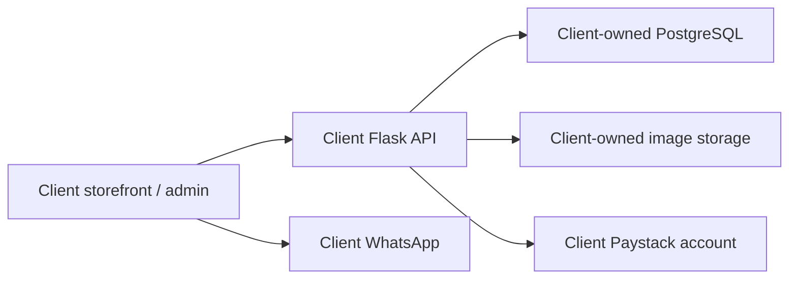

# Architecture

## One deployment per client

There is no shared tenant table, cross-store switching or shared customer database. Separation is by independent deployments and credentials, not a store ID added to queries. A unique store ID namespaces cookies and local cart storage; it does not compensate for sharing a database or session secret. Independent DB projects and separate storage accounts are the recommended boundary.

## Modules

- `app.py`: retained transaction-based commerce, authentication/invitations, product variants, owner receipt ledger, reservations, order snapshots and recorded analytics. `create_app` supports isolated test configuration.
- `extensions.py`: settings, category hierarchy, product lifecycle, enquiries, bank transfer claims, Paystack initiation/verification/webhook. Reuses commerce role guards and reconciliation.
- `store_config.py`: strict public setting allowlist, validated defaults/profile, database overrides. No secrets allowed. Deployment store identity cannot be changed from the dashboard.
- `migrations.py`: baseline schema and additive version-1 extensions, executed idempotently under PostgreSQL schema initialization locks. Future destructive schema changes require reviewed, versioned migration steps and backups; do not point this extraction at a previous client's database.
- `persistence.py`: SQLite local development, PostgreSQL adapter, signed Cloudinary/Supabase image uploads. Tables are schema-qualified, private schema permissions revoked for public/anonymous roles, and RLS enabled. The server DB owner intentionally accesses its own tables; browsers never connect directly to the DB.
- `gateway.py`: Paystack transport, fixed provider hostname and server-only authorization. Tests replace this boundary rather than making real network transactions.
- `static/app.js`: reusable rendering components and route binding: cards, grid, navigation, footer, forms, filters, notifications and admin screens. `editorial` and `electronics` are independent presentation treatments selected through public configuration. No frontend framework migration was needed.
- `profiles/default.json`: client-neutral defaults. `examples/sk-plug/store.json`: separately scoped example.

## Data model

`products` + `product_meta` store variants, prices in integer kobo, photos, featured/archive flags and specifications. Category parent relationships live in `category_meta`; cycles are rejected. `orders` contain immutable line snapshots and an idempotent checkout key. `payments` are verified receipts and append-only corrections; stock changes when product amounts are fully paid. `reservations` represent owner-held stock; a cart or new checkout does not automatically reserve it. `transfer_claims` never credit money. `gateway_payments` bind provider reference, exact amount and order. `owner`, `staff`, `owner_invitation` implement invitation-only role access; `product_audit`, `enquiries`, `store_settings`, and `request_limits` cover operations.

## Payment truth

Checkout validates current publication, availability, prices and fulfilment on the server. WhatsApp remains an explicit customer action. A bank reference only creates an unverified claim; the Super Admin checks the bank and records a verified receipt. Online payments are disabled unless explicitly enabled and configured with a server key. Both the return route and signed webhook verify with Paystack on the server, checking reference, successful status, NGN and exact amount before idempotent credit. A valid HMAC alone is not used as proof of payment. Duplicate verification cannot credit twice. Competing/manual receipts or dismissed orders require owner reconciliation rather than automatic over-crediting. Gateway failures never mark an order paid.

## Permissions

Super Admin: products/publication/lifecycle, settings, categories, enquiries, staff, orders and finances. Product Admin: image upload, category creation, draft creation/editing; no publication, live-product edits, accounts, finances or customer records. Permissions are checked on each protected API, independently of navigation visibility. Owner/staff invitation tokens are stored hashed and expire in 24 hours; password resets/revocation invalidate active sessions. No public account-creation endpoint exists.

## Security and operating limits

CSRF on state-changing browser APIs; raw-body HMAC on the separate Paystack webhook. Session cookies are HTTP-only, SameSite Lax and secure in production. CSP disables inline scripts/styles; validated themes are served as a separate stylesheet. Phone images are resized to at most 1600px and 3 MB before upload to fit serverless request limits. Uploaded raster images are decoded, pixel/size bounded, stripped of EXIF and re-encoded to WebP. HTML text is escaped. Schema, remote image origins and setting keys are constrained. Rolling DB-backed request limits run across serverless workers; the trusted hosting ingress must supply a meaningful remote address (forwarded headers are not blindly trusted).

Product availability uses one aggregated reservation query and one metadata query per request instead of queries per variant/product. Request-limit, reservation and payment lookup indexes support the common paths. Catalogue and order lists remain unpaginated: suitable for small stores, not benchmarked for a large marketplace. Schema creation still runs on cold start; move reviewed migrations into a deployment step for larger installations. There is no fulfilment/returns/refund ledger, shipping-price engine, automated email/SMS, 2FA, background webhook retry queue, or arbitrary staff-role editor. Backup/restore, monitoring, privacy approval and live provider checks are client launch responsibilities. The public enquiry endpoint needs spam monitoring and retention procedures. This is not a PCI card-data capture application; card entry is hosted by Paystack.
